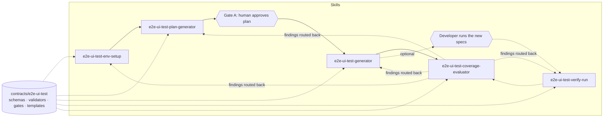
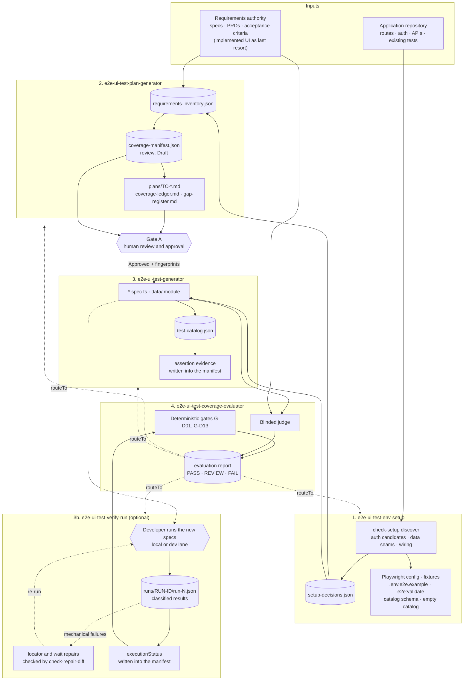
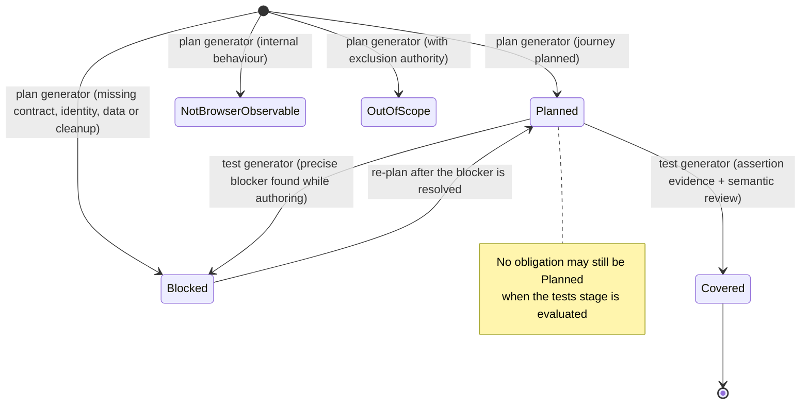
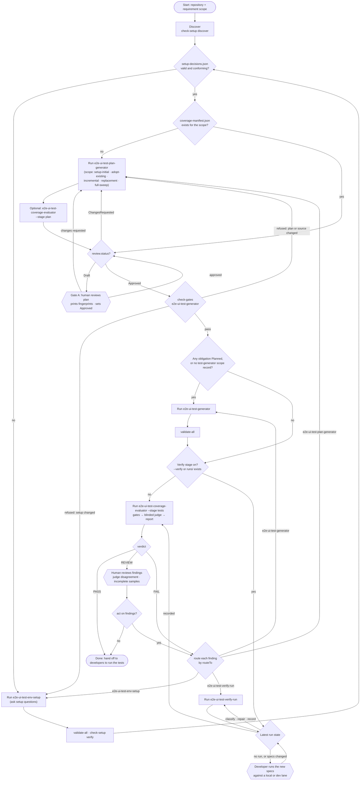
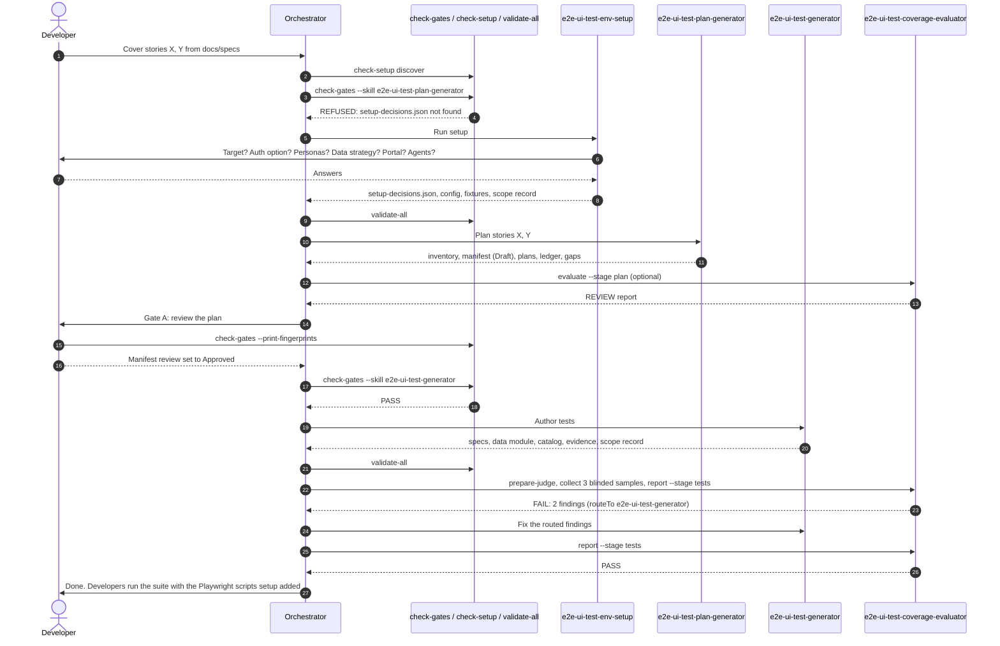
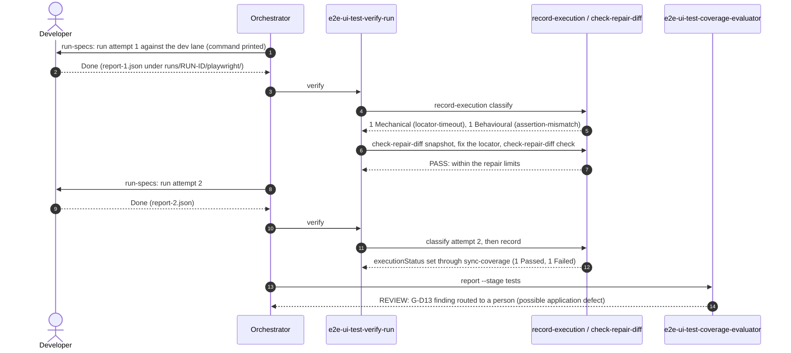
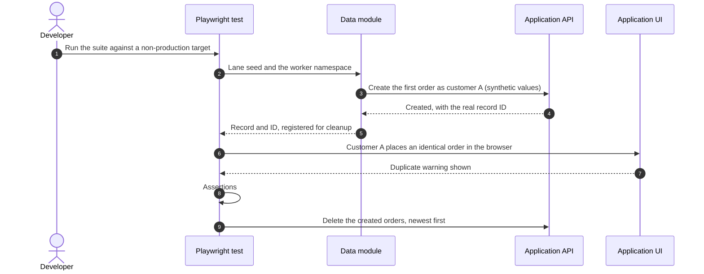

# E2E UI testing skills: guide

This guide explains the E2E testing skills, how their outputs flow from one to the next, how to run them end to
end with the orchestrator described below, what each one produces, how to use them day to day, how to verify
generated tests against a developer's run, and how test data is created and who is responsible for it.

- [1. Overview](#1-overview)
- [2. Purpose of the skills](#2-purpose-of-the-skills)
- [3. High-level data flow](#3-high-level-data-flow)
- [4. Orchestrator](#4-orchestrator)
- [5. Outputs of each skill](#5-outputs-of-each-skill)
- [6. Usage](#6-usage)
- [7. Test data](#7-test-data)
- [8. Reference](#8-reference)

---

## 1. Overview

The E2E testing framework turns requirements (specifications, PRDs, acceptance criteria) into reviewed,
traceable Playwright end-to-end tests, and then grades how completely and honestly those tests cover the
requirements. It works for any web application: nothing assumes a domain, framework, database or identity
provider.

It is made of four core skills, an optional verify skill, an orchestrator skill that runs them end to end, and
one shared contracts package:

| Part | Role | One-line summary |
| --- | --- | --- |
| [`e2e-ui-test-env-setup`](../../skills/e2e-ui-test-env-setup/SKILL.md) | Set up | Prepares the Playwright environment and records every setup decision |
| [`e2e-ui-test-plan-generator`](../../skills/e2e-ui-test-plan-generator/SKILL.md) | Plan | Turns requirements into a traceable, reviewable test plan before any code exists |
| [`e2e-ui-test-generator`](../../skills/e2e-ui-test-generator/SKILL.md) | Build | Writes Playwright specs from an **approved** plan, with assertion evidence |
| [`e2e-ui-test-verify-run`](../../skills/e2e-ui-test-verify-run/SKILL.md) | Verify (optional) | Reads a developer's run of the new specs, repairs broken locators and waits, and records which tests passed |
| [`e2e-ui-test-coverage-evaluator`](../../skills/e2e-ui-test-coverage-evaluator/SKILL.md) | Grade | Checks completeness and whether the tests really prove the requirements |
| [`e2e-ui-test-orchestrator`](../../skills/e2e-ui-test-orchestrator/SKILL.md) | Orchestrate | Runs the skills end to end, stopping wherever a person must act |
| [`.agents/contracts/e2e-ui-test`](README.md) | Contracts | Schemas, validators, entry gates, templates and rules shared by all the skills |

Two principles hold everywhere:

- **The skills never execute.** The skills write files and run static checks. They never run tests, browsers,
  the application, authentication flows or workflows. Developers run the tests. When a developer runs the new
  specs against a local or dev lane, `e2e-ui-test-verify-run` reads their report; it never runs anything itself.
- **Humans approve, files hand off.** Every hand-off between skills is a machine-checked file, and a person
  approves the plan (Gate A) before any test code is written.



### Layout

The skills and the contracts must stay siblings under `.agents/` at the repository root: the skills link to
`../../contracts/e2e-ui-test/...`, their commands run `node .agents/contracts/e2e-ui-test/scripts/...`, and the scripts find the
skills through the same layout.

```text
.agents/
  skills/
    e2e-ui-test-env-setup/          SKILL.md, references/
    e2e-ui-test-plan-generator/     SKILL.md, references/
    e2e-ui-test-generator/          SKILL.md, references/
    e2e-ui-test-verify-run/         SKILL.md, references/
    e2e-ui-test-coverage-evaluator/ SKILL.md, references/
    e2e-ui-test-orchestrator/       SKILL.md
  contracts/
    e2e-ui-test/                    scripts/, schemas/, templates/, GUIDE.md, README.md, invariants.md, test-data.md
```

---

## 2. Purpose of the skills

A single "generate my E2E tests" skill tends to produce tests that look complete but are not: a fixed two
journeys per story, criteria silently skipped, mocked responses reported as proven behaviour, and approvals
that nobody actually gave. Splitting the work into separate skills with checked hand-offs addresses each of these.

| Problem | How the framework prevents it |
| --- | --- |
| Criteria silently omitted | Every content unit under every criteria heading is accounted for (gate G-D01) |
| Business requirements (FR, NFR) not traceable | Source-owned identifiers become the primary traceability key (gate G-D02) |
| Sampling disguised as coverage | Journey counts must follow obligations; uniform counts fail (gate G-D06) |
| Tests written before anyone agreed on the plan | The test generator refuses unless the plan is approved and unchanged |
| "Covered" without real proof | Each claim needs an anchored assertion and a semantic review; a blinded judge re-checks it |
| Mocks passed off as backend behaviour | Evidence layer and mocking scope are recorded; seeded data enables integrated evidence |
| Skills changing files they do not own | Each skill records its touched files, and the evaluator re-checks them (gate G-D11) |
| One shared login pretending to be many roles | Auth state is kept per persona; development tokens give real per-role identities |
| Unrealistic or unsafe test data | Deterministic synthetic data through the application's own API, with cleanup |
| Tests that pass every check but fail the first time they run | Optional verify run: a developer runs the new specs, mechanical failures are repaired within script-enforced limits, and real results are recorded (gate G-D13) |
| An automated fix that makes a test pass a bug | Repairs may change locators, waits and navigation only; `check-repair-diff.mjs` rejects any change to what a test asserts |

### Responsibilities and boundaries

| Skill | Owns | Never does |
| --- | --- | --- |
| `e2e-ui-test-env-setup` | Playwright config, shared fixtures, environment contract, auth-state scaffolding, npm scripts, ignores, READMEs, optional portal workflow, `setup-decisions.json` | Write plans, specs or evaluations |
| `e2e-ui-test-plan-generator` | Requirements inventory, coverage manifest, plans, coverage ledger, gap register | Write specs, catalog entries or configuration; approve its own plan |
| `e2e-ui-test-generator` | Specs, synthetic data module, catalog entries, assertion evidence | Change plan scope, configuration, shared fixtures or workflows |
| `e2e-ui-test-verify-run` | Run reports and repair reports under `runs/`, locator and wait repairs in test sources, `executionStatus` in the manifest | Run Playwright, change assertions or test identity, change coverage status, fixtures, data builders or the catalog |
| `e2e-ui-test-coverage-evaluator` | Evaluation reports and judge bundles | Fix anything it finds |

For unit, integration and API test cases, use the separate `test-case-generator` skill; it hands E2E journey
planning to `e2e-ui-test-plan-generator`.

---

## 3. High-level data flow

### Artifacts moving between the skills



### What each hand-off file guarantees

| File | Written by | Read by | Guarantee |
| --- | --- | --- | --- |
| `setup-decisions.json` | setup | plan, test, evaluator | Target, auth mode, personas, browsers, data strategy and portal were confirmed from evidence or an explicit answer |
| `requirements-inventory.json` | plan | test, evaluator | Every criterion, content unit and source-owned identifier in scope is extracted verbatim with fingerprints |
| `coverage-manifest.json` | plan, then test, then verify-run (execution fields only) | test, verify-run, evaluator | Every obligation has a status; the `review` block holds the approval and plan fingerprint; `executionStatus` is `NotRun` unless a recorded run supports it |
| `test-catalog.json` | test | evaluator, portal | Every test has a stable identity, requirement references and readiness |
| `runs/<run-id>/run-<n>.json` | verify-run | verify-run, evaluator | Each result of a developer's run is mapped to its testId and classified, with spec fingerprints and no page text |
| `scope/<skill>-<time>.json` | setup, plan, test, verify-run | evaluator | The files a skill touched stayed inside what it owns |
| `runs/<run-id>/triage-<n>.json`, `dashboard-<n>.html` | verify-run | people | Every failed or flaky test is explained with one fault, its evidence, the fix and its owner |
| `evaluations/evaluation-*.json` | evaluator | people, other skills | Gate results, scores, verdict and routed findings |
| `evaluations/judge-report-*.json` | evaluator | people | Each obligation's judge outcome and sample justifications, with the model and dispatch mode |

### Obligation lifecycle

Every requirement is decomposed into obligations. Their status moves as the pipeline progresses:



Execution status is separate from coverage status. It stays `NotRun` until a developer runs the tests and
`e2e-ui-test-verify-run` records the result from their report (`Passed`, `Failed` or `Skipped`). A failing test
never changes coverage status: its obligation stays `Covered` with `executionStatus: Failed`, and the evaluator
routes the failure to its owner (section 6.8).

---

## 4. Orchestrator

The [`e2e-ui-test-orchestrator`](../../skills/e2e-ui-test-orchestrator/SKILL.md) skill runs the pipeline end to end. The pipeline is
driven by the state of the hand-off files, so the orchestrator needs no memory: it inspects the repository, decides the
next step, runs the matching skill, and repeats. The decision is made by a script, so it is the same every time:

```text
node .agents/contracts/e2e-ui-test/scripts/pipeline-status.mjs --root <repo> --docs-root <docs-e2e-root> [--verify] [--json]
```

It returns `step` (`setup`, `plan`, `gate-a`, `author`, `run-specs`, `verify`, `evaluate`, `route-findings`,
`human-review` or `done`), the owning `skill`, whether it is a `humanCheckpoint`, the `reason`, hints such as the
plan scope to use or the command for a verify run, and the latest evaluation's findings grouped by owner. Anyone
can run it to see where a repository stands.

The `run-specs` and `verify` steps belong to the optional verify stage (section 4.5). It is on when `--verify` is
passed, and stays on once `<docs-e2e-root>/runs/` exists, so a verify run that has started is never skipped.

### 4.1 Rules the orchestrator follows

1. **Decide from files, not from conversation.** Every decision below is derived from the hand-off files and the
   entry gates.
2. **Always run the entry gate first.** If `check-gates.mjs` refuses (exit code 2), follow its remediation; it
   names the skill to run.
3. **Stop at human checkpoints.** Setup questions, Gate A approval, running the specs for a verify attempt and
   `REVIEW` verdicts need a person. The orchestrator never approves a plan or edits the manifest `review` block.
4. **Route findings to their owner.** Each evaluation finding has `routeTo`; the orchestrator sends it to that
   skill and never fixes findings itself.
5. **Never execute.** No skill runs a test, browser, application, authentication flow or workflow at any step.
   Every execution result comes from a run the developer performed.
6. **Bound the loop.** Stop after a set number of fix-and-re-evaluate rounds (three is a sensible default) and
   hand the remaining findings to a person.

### 4.2 Pipeline



#### Step by step

Each numbered step is a stage in the diagram above. The pipeline always re-enters at the first step whose
condition is not met, so an interrupted run resumes without repeating finished work.

**1. Discover the repository.** `check-setup.mjs discover` reports development-authentication candidates and
their guards, data seams (create, delete, reset, seed), validation wiring, auth-state references, route
mocking, portal readiness and agent definitions. Nothing is written. This comes first so the setup questions
are answered from evidence instead of guesses.

**2. Record the setup — `e2e-ui-test-env-setup`.** Runs when `setup-decisions.json` is missing, or when it no longer
matches the repository. The skill asks only what discovery cannot answer (target, authentication choice,
personas, browsers, test-data strategy, portal, agent platform), then writes the Playwright config, fixtures,
`.env.e2e.example`, `e2e:*` scripts, ignore rules, READMEs, the catalog schema and `setup-decisions.json`,
plus a scope record of what it touched. `validate-all` and `check-setup verify` re-check the result; anything
they reject comes back to this step. **A person answers the questions.**

**3. Plan the coverage — `e2e-ui-test-plan-generator`.** Reads the requirements authority and extracts every criterion
verbatim into `requirements-inventory.json` with fingerprints, decomposes them into obligations, plans journeys
against those obligations, and writes the plans, coverage ledger and gap register. The manifest `review` block
starts as `Draft`. No obligation is `Covered` yet: they start `Planned`, or `Blocked`, `NotBrowserObservable`
or `OutOfScope` with a stated reason. The scope mode decides how much is re-planned — `setup-initial`,
`adopt-existing`, `incremental`, `replacement` or `full-sweep`.

**4. Audit the plan before approving (optional).** `e2e-ui-test-coverage-evaluator --stage plan` runs the gates that
apply before code exists, mainly: is any criterion or requirement identifier unaccounted for, and do the
journey counts follow the obligations. A plan-stage verdict is `REVIEW` at best, because a plan cannot prove
anything yet.

**5. Gate A: approve the plan.** The one step no skill performs. A reviewer reads the plans, ledger and gap
register, prints the fingerprints, and records `status: "Approved"` with reviewer, date, commit and the plan
fingerprint (section 6.4). The fingerprint is what makes approval meaningful: any later edit to plan-owned
content invalidates it, so test code can never rest on a plan nobody agreed to. Regions marked `coverage-view`
are excluded, which lets the test generator write results back into the plans without breaking the approval.
**A person approves.**

**6. Author the tests — `e2e-ui-test-generator`.** Its entry gate runs first and refuses if the plan changed after
approval (back to step 5), a source specification changed (back to step 3 with scope `replacement`) or
`setup-decisions.json` changed (back to step 2). Once it passes, the skill writes the spec files with
`@e2e-meta` identity and `@e2e-evidence` anchors, the synthetic-data module for seeded lanes, catalog entries
and assertion evidence, and moves each obligation from `Planned` to `Covered` or to `Blocked` with a precise
blocker. `validate-all` runs afterwards.

**7. Verify against a developer's run (optional) — `e2e-ui-test-verify-run`.** Only when the verify stage is on.
A developer runs the new specs once against a local or dev lane with the command `pipeline-status` prints. The
skill classifies each failure, repairs mechanical ones (wrong locator, missing wait) within the limits
`check-repair-diff.mjs` enforces, and asks for a re-run, at most two repair rounds. It then records
`executionStatus` for every obligation whose tests ran. Environment problems and possible application defects are
never repaired; they are reported to their owner. Section 4.5 shows the loop. **A person runs the specs.**

**8. Evaluate — `e2e-ui-test-coverage-evaluator --stage tests`.** Three passes: the deterministic gates G-D01 to G-D13
(accounting, traceability, proportionality, evidence, file scope, setup conformance, and recorded execution
evidence when there is any), then the blinded judge,
which re-reads each claim without knowing what the manifest asserts and votes on whether the test really proves
the criterion, then the report with scores, findings and a verdict. Every finding carries `routeTo`, the skill
that owns the fix.

**9. Act on the verdict.**

| Verdict | What happens next |
| --- | --- |
| `FAIL` | Each finding goes to its `routeTo` skill, upstream owners first (setup, then plan, then tests, then verify), and step 8 runs again. Bound this to about three rounds. |
| `REVIEW` | If judge samples are missing or incomplete, collect them and report again. Otherwise **a person decides** on the flagged findings and routes any fixes. A recorded failing test (gate G-D13) lands here: a person decides whether the application or the requirement is wrong. |
| `PASS` | The pipeline is done. Developers run the suite. Execution status is `NotRun` unless a verify run recorded results. |

### 4.3 Next-step decision table

Evaluate the rows top to bottom and take the first match.

| # | Repository state | Next step | Human checkpoint |
| --- | --- | --- | --- |
| 1 | No `setup-decisions.json`, or `check-setup verify` reports findings owned by setup | `e2e-ui-test-env-setup` ("Record existing setup" when Playwright already exists) | Answer setup questions |
| 2 | No `coverage-manifest.json` for the requested scope | `e2e-ui-test-plan-generator` (scope `adopt-existing` when plans or a ledger already exist) | — |
| 3 | `review.status` is `Draft` | Optional plan-stage evaluation, then stop for Gate A | Approve or request changes |
| 4 | `review.status` is `ChangesRequested` | `e2e-ui-test-plan-generator` with the reviewer's notes | — |
| 5 | Approved, but the test-generator gate refuses | Follow the refusal: re-plan (plan or source changed) or reconfigure (setup changed) | Re-approve after re-planning |
| 6 | Approved and some obligation is still `Planned`, or no test-generator scope record exists | `e2e-ui-test-generator` | — |
| 7 | Verify stage on, and no run yet or the specs changed since the latest run | Stop: `run-specs` | Run the specs with the printed command |
| 8 | Verify stage on, and the latest run is unclassified, has repairable failures within the attempt limit, or is not yet recorded | `e2e-ui-test-verify-run` (`verify`) | — |
| 9 | Tests authored (and, with the verify stage, results recorded) and not yet evaluated since the last change | `e2e-ui-test-coverage-evaluator --stage tests` (with the judge) | Collect judge samples |
| 10 | Verdict `FAIL` | Send each finding to its `routeTo` skill, then back to row 9 | — |
| 11 | Verdict `REVIEW` | Stop | Decide on judge disagreements, flagged findings and recorded failing tests |
| 12 | Verdict `PASS` | Stop: developers run the tests | Run the suite |

### 4.4 Sequence of one full run



### 4.5 Verify stage

The verify stage sits between authoring and evaluation. `pipeline-status` works out its state from files only:
raw Playwright reports under `runs/<run-id>/playwright/report-<n>.json` and classified reports under
`runs/<run-id>/run-<n>.json`. Run IDs are timestamps (`YYYYMMDD-HHmm`), so the latest run sorts last.

| Latest run state | Step | Who acts |
| --- | --- | --- |
| No run yet | `run-specs` | The developer runs attempt 1 with the printed command |
| A raw report with no classified report | `verify` (classify) | `e2e-ui-test-verify-run` |
| Repairable failures, attempt 1 or 2 | `verify` (repair) | `e2e-ui-test-verify-run` edits locators or waits, and `check-repair-diff.mjs` checks each edit |
| Specs changed after the latest attempt | `run-specs` | The developer runs the next attempt |
| No repairable failures, or attempt 3 reached | `verify` (record) | `e2e-ui-test-verify-run` records `executionStatus` |
| Recorded | Continue to evaluation | — |



The repair limits are the heart of the stage. A repair may change locators, element and page waits, navigation,
and which existing shared fixture a spec imports. It may not change any `expect` (matcher, expected value,
`.not`, `soft`, `await`), test titles, `@e2e-meta` or `@e2e-evidence`, skips or other test controls. It may not
add control flow, mocks, `evaluate`, `force: true`, `waitForTimeout`, `networkidle` or `.catch()`, and it may not
touch fixtures, synthetic-data builders, the catalog or configuration. The script enforces this; the skill cannot
talk its way around it. What the script cannot see is meaning: a new locator that matches the wrong element
passes it, so every repair is listed for a person to review.

### 4.6 Running the orchestrator

Ask for it by intent, for example "run the E2E pipeline for US-021 and US-022 from docs/specs" or "continue the
E2E pipeline". The `e2e-ui-test-orchestrator` skill loads, runs `pipeline-status.mjs`, and follows the loop below.

The orchestrator runs the contract scripts itself, so a developer's part in a run is: answer the setup questions,
approve the plan at Gate A (section 6.4), run the new specs when the verify stage asks, decide any findings a
`REVIEW` verdict raises, and run the suite at the end. The orchestrator asks at the start whether to use the verify
stage (default no). The commands in section 6.5 are there for when you want to check the state yourself, not chores the
orchestrator hands out. A run may span several sessions: `pipeline-status` rebuilds the state from the files, so
"continue the E2E pipeline" resumes from the same point.

In an agent that cannot load skills, paste this prompt instead. Replace the bracketed values.

```text
Act as the E2E pipeline orchestrator for this repository, using the e2e-ui-test-env-setup, e2e-ui-test-plan-generator,
e2e-ui-test-generator, e2e-ui-test-verify-run and e2e-ui-test-coverage-evaluator skills and the guide in
.agents/contracts/e2e-ui-test/GUIDE.md.

Scope: [story IDs or feature], authority: [spec or PRD paths], docs root: [docs/tests_e2e],
verify against a dev run: [yes/no].

Loop:
1. Run node .agents/contracts/e2e-ui-test/scripts/pipeline-status.mjs --root . --docs-root <docs root> --json
   (add --verify when verifying) and act on its step (the decision table in GUIDE.md section 4.3).
2. Before running a skill, run its entry gate: node .agents/contracts/e2e-ui-test/scripts/check-gates.mjs --skill <skill> --docs-root <docs root>.
   If it refuses, follow the remediation it prints.
3. Run the chosen skill, then run node .agents/contracts/e2e-ui-test/scripts/validate-all.mjs --docs-root <docs root>.
4. After an evaluation, send each finding to the skill named in routeTo.

Stop and ask me whenever a skill needs a setup answer, at Gate A plan approval, when the specs must be run for a
verify attempt (give me the runCommand), and on a REVIEW verdict.
Never approve the plan or edit the manifest review block yourself. Never run tests, browsers, the application,
authentication or workflows. Stop after 3 fix-and-re-evaluate rounds and summarize what remains.
After every step, report: the step, files written, gate results, and the next step.
```

---

## 5. Outputs of each skill

Paths below use the defaults: documents in `docs/tests_e2e/` and tests in the existing Playwright `testDir`
(or `tests/e2e/`). Setup reuses existing folders when a repository already has them.

### 5.1 `e2e-ui-test-env-setup`

| Output | Purpose | Commit |
| --- | --- | --- |
| `docs/tests_e2e/setup-decisions.json` | Every confirmed decision per lane: target, environment, auth mode and choice, personas and identities, browsers, data strategy and data contract, portability, portal, agent platform | Yes |
| `playwright.config.*` (new or minimally updated) | Discovery-safe configuration with explicit projects, timeouts and reporters | Yes |
| `<testDir>/fixtures/` | Shared entry point, environment gate, per-persona auth state, development-token and seeded-data fixtures when chosen | Yes |
| `.env.e2e.example` | Documented, non-secret environment variables | Yes |
| `package.json` scripts | `e2e:*` commands; `e2e:validate` runs `validate-all.mjs` | Yes |
| `.gitignore` entries | Ignore secrets, auth state, test output and raw verify-run output (`<docs-e2e-root>/runs/*/playwright/`); keep hand-off files and run reports committable | Yes |
| `<testDir>/README.md`, `docs/tests_e2e/README.md` | How the setup works and how to run it | Yes |
| `<testDir>/test-catalog.schema.json`, empty `test-catalog.json` | Repository catalog contract | Yes |
| `.github/workflows/execute-tests.yml` (optional) | Manual portal workflow, only when an entry can be `Ready` | Yes |
| Agent definitions (optional) | Only for the confirmed agent platform | Yes |
| `docs/tests_e2e/scope/setup-<time>.json` | Record of the files this run touched | Yes |

### 5.2 `e2e-ui-test-plan-generator`

| Output | Purpose | Commit |
| --- | --- | --- |
| `docs/tests_e2e/requirements-inventory.json` | Verbatim criteria with fingerprints, every content unit accounted for, source-owned identifiers (FR, NFR) as requirement groups | Yes |
| `docs/tests_e2e/coverage-manifest.json` | Obligations with status, planned journeys, data requirements, and the `review` block (starts `Draft`) | Yes |
| `docs/tests_e2e/plans/TC-<feature>-<story>.md` | Per-story journeys `TC-J01...` with planned assertions | Yes |
| `docs/tests_e2e/coverage-ledger.md` | Story, criterion and persona coverage, plus requirement-identifier coverage | Yes |
| `docs/tests_e2e/gap-register.md` | Every non-covered obligation with blocker, remediation and owner | Yes |
| Rollups, reference fingerprints and `coverage-data` / `coverage-groups` blocks | Derived from the manifest by `sync-coverage.mjs`, never hand-edited | Yes |
| `docs/tests_e2e/scope/plan-<time>.json` | Record of the files this run touched | Yes |

### 5.3 `e2e-ui-test-generator`

| Output | Purpose | Commit |
| --- | --- | --- |
| `<testDir>/**/*.spec.ts` | Journeys with `@e2e-meta` identity and `@e2e-evidence` assertion anchors | Yes |
| `<testDir>/data/` (seeded lanes) | Deterministic synthetic-data builders and expected values | Yes |
| `test-catalog.json` entries | Stable test identity, requirement references, readiness, portal eligibility | Yes |
| Updates to `coverage-manifest.json` | Test IDs, assertion references, mocking scope, semantic review, statuses, recorded with `sync-coverage.mjs` | Yes |
| Updates inside plans, ledger and gap register | Only the `coverage-data` blocks and `coverage-view` regions, rebuilt by `sync-coverage.mjs` | Yes |
| `docs/tests_e2e/scope/test-<time>.json` | Record of the files this run touched; the evaluator requires it | Yes |

### 5.4 `e2e-ui-test-verify-run` (optional)

| Output | Purpose | Commit |
| --- | --- | --- |
| `docs/tests_e2e/runs/<run-id>/run-<n>.json` | One attempt's results: each test and project mapped to its testId, failures classed Mechanical, Environment, Behavioural or Unclassified, spec fingerprints, results not matched to a testId (with their outcome), errors outside any test, and Playwright's own totals. No page text | Yes |
| `docs/tests_e2e/code-graph.json` | Written only when a person skips a stale or missing code graph, so no later step asks again. `code-nav.mjs decide` writes it | Optional |
| `docs/tests_e2e/runs/<run-id>/triage-<n>.json` | For each failed or flaky test: what went wrong, the evidence, why that fault and not the other side (`whyThisFault`, schema 1.1), one fault (DeveloperBug, AgentTestBug, Environment, TestData, RequirementGap, Undetermined), the fix and its owner. Schema `run-triage.schema.json` | Yes |
| `docs/tests_e2e/runs/<run-id>/dashboard-<n>.html` | One self-contained readable page for the attempt, built by `render-run-dashboard.mjs`, with developer bugs and agent test-code bugs shown apart. `pipeline-status` requires it (and the triage when a test did not pass) before the verify stage ends | Yes |
| `docs/tests_e2e/runs/<run-id>/repair-<n>.json` | What `check-repair-diff.mjs` found in the repairs after attempt `<n>` | Yes |
| Locator and wait repairs in test sources | Only within the repair limits (section 4.5) | Yes, after review |
| Updates to `coverage-manifest.json` | `executionStatus` and `resultReference` only, recorded through `sync-coverage.mjs`; coverage status never changes | Yes |
| `docs/tests_e2e/scope/verify-<time>.json` | Record of the files this run touched | Yes |

The raw Playwright output the developer produces (`runs/<run-id>/playwright/`: JSON reports, traces, error context,
screenshots) is git-ignored, because it can contain page text and personal data.

### 5.5 `e2e-ui-test-coverage-evaluator`

| Output | Purpose | Commit |
| --- | --- | --- |
| `docs/tests_e2e/evaluations/evaluation-<stage>-<time>.json` | Gate results, scores, counts, findings with `routeTo`, verdict | Optional, useful history |
| `docs/tests_e2e/evaluations/evaluation-<stage>-<time>.md` | Readable version of the same report | Optional |
| `docs/tests_e2e/evaluations/judge-report-<stage>-<time>.json` and `.md` | The committed judge record: each obligation's outcome, every sample's justification and cited line, the model and the dispatch mode (batched by sample number, or per sample), and the criterion re-derivation result | Optional, useful history |
| `docs/tests_e2e/evaluations/judge-<time>/` | Blinded judge bundles, `prompts.json` (`batches` by sample number, the default, and `samples` per bundle) and the raw samples (working files) | No |

Verdicts:

| Verdict | Meaning |
| --- | --- |
| **FAIL** | A blocking gate failed, a high-severity finding exists, or the score is below 3.0 |
| **REVIEW** | A person must decide: judge disagreement or missing samples, flagged claims, a recorded failing test or stale run evidence (G-D13), a score below 4.2, or scores covering under half of the scoring weight. A plan-stage evaluation is `REVIEW` at best |
| **PASS** | Every gate passed and the judge found the tests support their requirements. On its own it never means the tests pass when run; only the report's `executionStatus`, transcribed from a recorded verify run, says that |

### 5.6 Files created by developers, never by the skills

`.env.e2e`, `.auth/`, `test-results/`, `playwright-report/`, and the raw verify-run output under
`<docs-e2e-root>/runs/*/playwright/`. Setup adds them to `.gitignore`; never commit them.

---

## 6. Usage

### 6.1 Prerequisites

- Node.js 20 or later, and git.
- A web application with a browser-facing UI, and Playwright with `typescript` installed in the owning package.
- The skills and contracts copied under `.agents/` as shown in [Layout](#layout).
- Requirements in Markdown with headings (specs, PRDs or acceptance criteria documents). If a repository has
  none, see [6.7 Repositories without PRDs, specs or acceptance criteria](#67-repositories-without-prds-specs-or-acceptance-criteria).

### 6.2 Scenarios

**New repository without Playwright**

1. `e2e-ui-test-env-setup` (new setup) → answer the setup questions.
2. `e2e-ui-test-plan-generator` (scope `setup-initial`) → review and approve the plan.
3. `e2e-ui-test-generator` → `e2e-ui-test-coverage-evaluator --stage tests`.

**Repository with existing Playwright tests but no plans or manifest**

1. `e2e-ui-test-env-setup` with "Record existing setup": derives decisions from the repository and changes nothing else.
2. `e2e-ui-test-plan-generator` with scope `adopt-existing`: existing test mappings become unverified claims.
3. Approve the plan, then `e2e-ui-test-generator` reviews the claimed tests and records real evidence.

**Adding a new story to an established setup**

1. `e2e-ui-test-plan-generator` with scope `incremental` and the exact story IDs.
2. Approve, then `e2e-ui-test-generator`, then evaluate.

**A specification changed after approval**

The test generator refuses ("Source spec changed after approval"). Re-plan with scope `replacement` naming the
affected plans or journeys, re-approve, then regenerate.

**Code is implemented but there are no PRDs, specs or acceptance criteria**

1. Derive acceptance criteria from the code into a spec marked as implementation-derived, and have a product
   owner confirm it (section 6.7).
2. `e2e-ui-test-plan-generator` with that spec as the explicit authority, then continue as for any other story.

**Checking coverage only**

Run `e2e-ui-test-coverage-evaluator` at the `plan` stage (before approval) or the `tests` stage (after authoring).

**Checking that newly generated tests actually run**

After `e2e-ui-test-generator`, run the new specs once against a local or dev lane and hand the report to
`e2e-ui-test-verify-run` (section 6.8). Then evaluate as usual.

### 6.3 Example prompts

| Skill | Example request |
| --- | --- |
| `e2e-ui-test-env-setup` | "Set up Playwright E2E for this repo. Target is local; tell me which authentication options you find." |
| `e2e-ui-test-env-setup` | "We already have Playwright tests; record the existing setup so the planner can run." |
| `e2e-ui-test-env-setup` | "Reconfigure the local lane to create synthetic test data through the API instead of route mocks." |
| `e2e-ui-test-plan-generator` | "Plan E2E coverage for US-014 and US-015 from docs/specs. Don't write any spec files yet." |
| `e2e-ui-test-plan-generator` | "Adopt our existing E2E plans and ledger into a coverage manifest." |
| `e2e-ui-test-generator` | "Generate the Playwright tests for the approved plan in docs/tests_e2e." |
| `e2e-ui-test-generator` | "Review the claimed tests in the manifest and record their assertion evidence." |
| `e2e-ui-test-coverage-evaluator` | "Before I approve the plan, audit it: are any acceptance criteria or FRs missing?" |
| `e2e-ui-test-coverage-evaluator` | "Evaluate the tests stage and run the blinded judge." |
| `e2e-ui-test-plan-generator` | "Plan E2E coverage for the orders feature using docs/specs/derived/orders.md as the authority." |
| `e2e-ui-test-verify-run` | "I ran the new specs against dev; the report is in docs/tests_e2e/runs/20260930-1000/playwright/report-1.json. Classify it and fix what you're allowed to." |
| `e2e-ui-test-verify-run` | "Attempt 2 is done. Record the results in the manifest." |
| `e2e-ui-test-orchestrator` | "Run the E2E pipeline for US-021 and US-022 from docs/specs." |
| `e2e-ui-test-orchestrator` | "Run the E2E pipeline for US-021 and verify the tests against our dev environment before evaluating." |
| `e2e-ui-test-orchestrator` | "Where is our E2E pipeline, and what is the next step? Continue it." |

### 6.4 Approving a plan (Gate A)

Approval is a deliberate human action. No skill records it, and `e2e-ui-test-generator` refuses to start until it is
recorded correctly. The commands below use the default docs root `docs/tests_e2e`; substitute yours.

**Step 1. Commit the plan exactly as generated.** Review what is committed, not files that may still change.

```bash
git add docs/tests_e2e
git commit -m "E2E plan for US-021 and US-022 (Draft)"
```

**Step 2. Review the plan.** Read the plans, coverage ledger and gap register against the checklist the plan
generator presents ([review-checklist.md](../../skills/e2e-ui-test-plan-generator/references/review-checklist.md)), and
check the data requirements (section 7.6). Optionally run the plan-stage evaluation first. If the plan needs
changes, go to [Requesting changes](#requesting-changes) instead.

**Step 3. Collect the values to record.**

```bash
node .agents/contracts/e2e-ui-test/scripts/check-gates.mjs --print-fingerprints --docs-root docs/tests_e2e
git rev-parse HEAD
git status --short docs/tests_e2e
```

The first command prints three fingerprints:

```json
{
  "setupDecisionsRef": { "path": "docs/tests_e2e/setup-decisions.json", "fingerprint": "1e1a6a0b…" },
  "requirementsInventoryRef": { "path": "docs/tests_e2e/requirements-inventory.json", "fingerprint": "2c89d1ab…" },
  "planFingerprint": "7cd3895c08dda9641facc38bb5fb9f0367d5c17e14f16163ca99e1039889484d"
}
```

- Copy only **`planFingerprint`**. The other two are already recorded by the plan generator and checked
  automatically.
- `git rev-parse HEAD` prints the full 40-character hash of the commit from step 1. Copy it.
- `git status` must print **nothing**. If it lists files, the working copy differs from the commit you reviewed:
  commit or discard those changes, then repeat steps 2 and 3.

**Step 4. Edit the `review` block** in `docs/tests_e2e/coverage-manifest.json`. The plan generator leaves it as:

```json
"review": {
  "status": "Draft",
  "reviewer": null,
  "reviewedAt": null,
  "reviewedCommit": null,
  "planFingerprint": null,
  "notes": null
}
```

Change it to:

```json
"review": {
  "status": "Approved",
  "reviewer": "Alex Morgan, Product Owner",
  "reviewedAt": "2026-09-16",
  "reviewedCommit": "4f9c2e1a7b3d5c8e0f1a2b3c4d5e6f7a8b9c0d1e",
  "planFingerprint": "7cd3895c08dda9641facc38bb5fb9f0367d5c17e14f16163ca99e1039889484d",
  "notes": null
}
```

| Field | What to enter | Format | Checked by the gate |
| --- | --- | --- | --- |
| `status` | `Approved` | Exactly this spelling and case; `approved` is rejected | Yes |
| `reviewer` | The person accountable for the approval | Any non-empty text. Use name and role (`Alex Morgan, Product Owner`), and an e-mail address if your team identifies people that way. A team, bot or `TBD` is not a reviewer | Only that it is not empty |
| `reviewedAt` | The date you made the decision | `YYYY-MM-DD`, for example `2026-09-16`. A full ISO timestamp such as `2026-09-16T14:30:00Z` is also accepted. `16/09/2026` and `16-09-2026` are rejected | Format only |
| `reviewedCommit` | The commit you reviewed, from `git rev-parse HEAD` in step 3 | The full 40-character hash. It is the commit that **contains the Draft plan**, not the approval commit you make in step 5, which cannot contain its own hash. A short hash is accepted but can become ambiguous | **Not verified.** It is the audit trail, so copy it carefully |
| `planFingerprint` | The `planFingerprint` value from step 3 | 64 lowercase hexadecimal characters, copied exactly, without extra spaces | Yes: recomputed and compared on every run |
| `notes` | Optional conditions or context | Text or `null` | No |

Recording the approval does not change the fingerprint: it covers the plan-owned content (scope, obligations,
planned journeys, data requirements, plan text outside `coverage-view` regions), not the `review` block.

**Step 5. Commit the approval and confirm the gate passes.**

```bash
git add docs/tests_e2e/coverage-manifest.json
git commit -m "Approve E2E plan for US-021 and US-022 (Gate A)"
node .agents/contracts/e2e-ui-test/scripts/check-gates.mjs --skill e2e-ui-test-generator --docs-root docs/tests_e2e
```

The last command must print `PASS (e2e-ui-test-generator): entry gates satisfied.` Test generation can now start:
ask for `e2e-ui-test-generator`, or say "continue the E2E pipeline".

#### Requesting changes

When the plan is not ready, record that instead of approving:

```json
"review": {
  "status": "ChangesRequested",
  "reviewer": "Alex Morgan, Product Owner",
  "reviewedAt": "2026-09-16",
  "reviewedCommit": "4f9c2e1a7b3d5c8e0f1a2b3c4d5e6f7a8b9c0d1e",
  "planFingerprint": null,
  "notes": "US-022 criterion 3 has no journey; split the refusal journey per persona."
}
```

Only `status` must change; the other fields may stay `null`, but recording them keeps the history. Always write
`notes`, as instructions: the plan generator and the orchestrator act on them. Re-planning returns the plan
to `Draft`, and approval starts again from step 1 with new values.

#### When an approval stops being valid

Any later change to plan-owned content, to a source specification or to `setup-decisions.json` makes the test
generator refuse until the plan is re-planned where needed and re-approved. To see what changed since the
approval, compare with the reviewed commit:

```bash
git diff <reviewedCommit> -- docs/tests_e2e
```

#### If the gate refuses after you approve

| Gate output | Cause | Fix |
| --- | --- | --- |
| `coverage-manifest.json is invalid (1 error(s)). Run e2e-ui-test-plan-generator.` followed by `manifest $.review.reviewedAt: does not match ^\d{4}-\d{2}-\d{2}` | The date is not `YYYY-MM-DD` | Correct the date. For a mistake in the `review` block, fixing the field is enough; you do not need to re-run the plan generator |
| `... $.review.reviewer: expected string, got null` or `shorter than 1` | `reviewer` left empty | Enter the reviewer |
| `... $.review.planFingerprint: does not match ^[a-f0-9]{64}$` | The fingerprint is truncated, uppercase or has extra characters | Copy it again from step 3 |
| `... $.review.status: must be one of "Draft", "ChangesRequested", "Approved", "Superseded"` | Wrong spelling or case | Enter `Approved` |
| `coverage-manifest.json is not valid JSON` | A missing quote or comma, or a trailing comma, while editing | Fix the JSON syntax |
| `Plan changed after approval; re-review.` | The wrong fingerprint was copied, or plan files changed after step 3 | Print the fingerprints again. If the plan itself changed, review the change with `git diff <reviewedCommit>` and approve again |

### 6.5 Everyday commands

The skills run these themselves while they work; developers run them only to inspect the state, or in CI. The
steps that are genuinely developer-owned are the Gate A fingerprints in section 6.4, running the specs for a
verify attempt (section 6.8), and running the tests.

| Purpose | Command |
| --- | --- |
| See where the pipeline stands and the next step | `node .agents/contracts/e2e-ui-test/scripts/pipeline-status.mjs --root . --docs-root docs/tests_e2e` |
| Find setup evidence (auth, data seams, wiring) | `node .agents/contracts/e2e-ui-test/scripts/check-setup.mjs discover --root .` |
| Check the recorded setup against the repository | `node .agents/contracts/e2e-ui-test/scripts/check-setup.mjs verify --root . --docs-root docs/tests_e2e` |
| Run every static validation | `npm run e2e:validate` (runs `validate-all.mjs`) |
| Check whether a skill may start | `node .agents/contracts/e2e-ui-test/scripts/check-gates.mjs --skill <skill> --docs-root docs/tests_e2e` |
| Classify a verify-run report | `node .agents/contracts/e2e-ui-test/scripts/record-execution.mjs classify --root . --docs-root docs/tests_e2e --report <report-n.json> --run-id <run-id> --attempt <n> --lane <laneId>` |
| Check repairs against the limits | `node .agents/contracts/e2e-ui-test/scripts/check-repair-diff.mjs check --root . --docs-root docs/tests_e2e --since <snapshot>` |
| Record a verify run in the manifest | `node .agents/contracts/e2e-ui-test/scripts/record-execution.mjs record --root . --docs-root docs/tests_e2e --run docs/tests_e2e/runs/<run-id>/run-<n>.json` |
| Evaluate | `node .agents/contracts/e2e-ui-test/scripts/evaluate.mjs report --stage tests --root . --docs-root docs/tests_e2e --catalog <catalog> --typescript <path to typescript.js>` |
| Run the tests (developer, outside the skills) | The Playwright scripts that setup added, listed in the test folder README |

> **Note: Playwright agents as a developer cross-check.** `e2e-ui-test-env-setup` installs the Playwright
> planner, generator and healer definitions for the confirmed agent platform; the skills never invoke them.
> Developers may run them on their own as an optional cross-check, against non-production targets only.
> For repairing broken generated tests, prefer the verify stage (section 6.8): its repairs are checked by a
> script, while the healer's limits exist only in its prompt.
>
> - **After the healer edits tests, re-run `e2e-ui-test-coverage-evaluator`.** Healer changes land after
>   the last verdict, so the previous `PASS` and the assertion evidence in the coverage manifest no longer
>   match the specs. Review every healer diff: a change to an `expect` or a test step is a requirement
>   question, not a fix.
> - **After upgrading Playwright, regenerate the agent definitions** through an `e2e-ui-test-env-setup`
>   reconfigure operation (agent platform). Plan and test runs never regenerate them. See
>   [Playwright Test Agents](https://playwright.dev/docs/test-agents).

### 6.6 Troubleshooting

| Message | Meaning | Action |
| --- | --- | --- |
| `setup-decisions.json not found` | No recorded setup | Run `e2e-ui-test-env-setup` ("Record existing setup" if Playwright exists) |
| `Plan is Draft; complete Gate A review` | Plan not approved | Review and approve the plan |
| `Plan changed after approval; re-review` | Plan-owned content changed | Re-approve, or re-plan if the change was unintended |
| `Source spec changed after approval; regenerate plan` | A requirement file changed | Re-plan with scope `replacement`, then re-approve |
| `Setup changed after planning; re-plan` | `setup-decisions.json` changed | Re-plan and re-approve |
| `Handoff file(s) ignored by git` | A `.gitignore` rule hides a hand-off file | Let `e2e-ui-test-env-setup` add the narrow exception it names |
| `coverage completeness is not checked` (validate-all) | No coverage manifest yet | Run `e2e-ui-test-plan-generator` |
| G-D01 failure | A criterion or content unit is unaccounted for | Re-plan; check the criteria headings |
| G-D06 failure | Journeys do not follow obligations | Re-plan with journeys per obligation, or request a labelled smoke sample |
| G-D11 failure | A skill touched files it does not own, or left no record | Undo those changes; rerun the skill so it records its scope |
| G-D12 failure | Setup and repository disagree | Follow the finding's `routeTo` (setup, or the test generator for spec issues) |
| `Raw Playwright output ... is not git-ignored` (verify-run gate) | `runs/*/playwright/` would be committed | Let `e2e-ui-test-env-setup` add the ignore rule |
| `setup-decisions.json has no local or dev lane` (verify-run gate) | Every lane looks like production | Add a local or dev lane with `e2e-ui-test-env-setup`; verify runs never target production |
| `spec(s) changed after the run` (`record-execution record`) | A spec was edited after the attempt ran | Run the next attempt and classify it, then record |
| `forbidden change(s)` (`check-repair-diff check`) | A repair touched an assertion, test identity, control flow or a protected file | Restore the file from the snapshot; make an allowed repair or report the failure |
| G-D13 finding | A recorded test failed, or its run report is stale or invalid | Follow `routeTo`: a person for Behavioural or Unclassified, setup for Environment, the test generator for Mechanical, verify-run for stale evidence |

### 6.7 Repositories without PRDs, specs or acceptance criteria

Some repositories have implemented features but no PRD, spec or acceptance criteria for them, or documents that
no longer match the code. The skills still work there, but the tests they produce mean something different, so
decide deliberately how to handle it.

**How the skills use the code.** The plan and test generators always read the application code (routes,
components, accessible names, forms, API clients, auth guards, existing tests) to ground routes and selectors,
even when specs exist. Separately, `e2e-ui-test-plan-generator` picks one primary requirements authority in this
order: a source path you name, a spec or PRD you supply, implementation specs, a PRD, and only then the
**implemented UI**. When it falls back to the implemented UI, it treats visible behaviour as the requirement,
records the source files used as evidence, and writes a `derivationRule` in `requirements-inventory.json`
explaining how requirement IDs were assigned, because code has no story IDs.

**Why code alone is a weak authority.**

| Risk | Consequence |
| --- | --- |
| Tests describe what the code does, not what it should do | A defect becomes the expected result, and the test protects it |
| The evaluation becomes circular | The evaluator and its judge compare tests with requirements taken from the same code, so they pass almost by default |
| Unimplemented rules are invisible | Limits, error paths and role rules the code never implemented never become obligations, so gaps go unreported |
| Scope is hard to name | The planner refuses broad scopes such as "remaining stories"; without story IDs you must scope by route or feature |

**Recommended approach.**

1. **Derive acceptance criteria first.** For each feature or route in scope, write a short Markdown spec under
   a `derived` folder (for example `docs/specs/derived/orders.md`) with an `## Acceptance Criteria` heading and
   one bullet per behaviour. State at the top that it is implementation-derived and name the source files. An
   assistant can draft it from the code, but keep this separate from the E2E pipeline.
2. **Have a product owner or business analyst confirm it.** They correct behaviour that is wrong, add rules the
   code is missing, and remove behaviour that is accidental. This review is what restores an authority that is
   independent of the code; without it the rest of the pipeline only checks the code against itself.
3. **Plan against the confirmed spec.** Name it as the explicit authority, for example "Plan E2E coverage for
   the orders feature using docs/specs/derived/orders.md as the authority." The inventory, Gate A, the
   fingerprints and the evaluator then work exactly as they do for any other spec, and an edit to the derived
   spec invalidates the approval like any source change.
4. **If nobody can confirm the spec,** you may still let the planner fall back to the implemented UI, but treat
   the result as characterization (regression) coverage: it detects change, not correctness. Say so in the plan
   summary and in the Gate A review notes, and do not report it as requirements coverage. Replace it with
   requirement-based coverage (scope `replacement`) once real acceptance criteria exist.

**Reviewing an implementation-derived plan at Gate A.** In addition to the usual checks in section 6.4, confirm
that the plan names its authority as implementation-derived, that the source files it cites exist and are the
ones you expect, that suspicious behaviour (odd validation, missing error messages, permissive roles) is listed
as a conflict or question rather than an expected result, and that the scope names concrete routes or features.

### 6.8 Verifying generated tests against a developer's run

The rest of the pipeline is static: a test can pass every gate and still fail the first time it runs, because of a
wrong accessible name, a missing wait or a seeding error. The verify stage closes that gap without letting any
skill execute. Use it for new or regenerated specs, before the tests-stage evaluation. The design and the
alternatives considered are in
[E2E-RUNTIME-FEEDBACK-DESIGN.md](../../../docs/guide/E2E-RUNTIME-FEEDBACK-DESIGN.md).

**Before the first verify run**

- [ ] `setup-decisions.json` has a local or dev lane. Production lanes are refused.
- [ ] `.gitignore` ignores `<docs-e2e-root>/runs/*/playwright/` (setup adds this); run reports beside it stay
      committable. The verify-run gate checks both.
- [ ] The lane works on your machine: `.env.e2e` is set, persona sign-in works, and seeding and cleanup work for
      seeded lanes (section 7.5).

**Each attempt**

1. **Run the specs.** Use the command `pipeline-status` or the skill prints. It writes the JSON report and failure
   traces into the ignored folder without changing the Playwright config:

   ```bash
   PLAYWRIGHT_JSON_OUTPUT_NAME=docs/tests_e2e/runs/<run-id>/playwright/report-<n>.json npx playwright test <specs> --project <project> --reporter=json --retries=1 --trace=retain-on-failure --output=docs/tests_e2e/runs/<run-id>/playwright/artifacts-<n>
   ```

   ```powershell
   $env:PLAYWRIGHT_JSON_OUTPUT_NAME = "docs/tests_e2e/runs/<run-id>/playwright/report-<n>.json"; npx playwright test <specs> --project <project> --reporter=json --retries=1 --trace=retain-on-failure --output=docs/tests_e2e/runs/<run-id>/playwright/artifacts-<n>
   ```

   `<run-id>` is the current time as `YYYYMMDD-HHmm` for a new run, and stays the same for later attempts.
   `--retries=1` stops noise from the dev environment from counting as a failure.
2. **Hand it to `e2e-ui-test-verify-run`** (or say "continue the E2E pipeline"). It classifies every failure:

   | Class | Example | What happens |
   | --- | --- | --- |
   | Mechanical | Locator timeout, several elements matched, element detached, assertion whose element was never found | Repaired within the limits (section 4.5), at most two rounds |
   | Environment | Connection refused, 401 or 403, missing auth state, error inside a fixture or data builder | Not repaired; routed to `e2e-ui-test-env-setup` or the environment owner |
   | Behavioural | Expected "Approved", received "Pending" | Never repaired: a possible application defect. The test stays as written, and a person decides |
   | Unclassified | A bare test timeout | Not repaired; a person opens the trace |

3. **If anything was repaired, review the diff and run the next attempt.** The skill lists every repair with its
   `repair-<n>.json` report. The script checks structure; you check that the new locator means the same element.
4. **When nothing repairable is left,** the skill records `executionStatus` (`Passed`, `Failed` or `Skipped`) for
   every obligation whose tests all ran, then the pipeline moves on to evaluation.

**What the evaluator does with it.** Gate G-D13 checks that each recorded result points to a valid run report
whose specs have not changed since, and turns each failed test into a finding for its owner. The gate is
non-blocking: a recorded failure makes the verdict `REVIEW`, not `FAIL`, because whether the application or the
requirement is wrong is a decision for a person. The report's `executionStatus` is transcribed from the recorded
results once every `Covered` obligation has one.

**What it does not do.** It does not improve what tests assert; that still depends on the requirements and the
plan. It does not replace running the full suite in CI. A later edit to a spec makes its recorded result stale,
and the stage asks for a new run.

---

## 7. Test data

Most requirements can only be proven against real records: an order that already exists, a list with nothing in
it, a record owned by somebody else. This section explains how the framework produces that data, who is
responsible for each part, and what developers must provide before the tests can run. The full contract is in
[test-data.md](test-data.md).

### 7.1 The three strategies

`e2e-ui-test-env-setup` asks which strategy each lane uses and records the answer as `dataStrategy` in
`setup-decisions.json`.

| Strategy | In plain terms | What the tests can prove | Records created |
| --- | --- | --- | --- |
| `api-seeded` (recommended) | Tests create made-up records through the application's own API, then remove them | Real backend behaviour: saving, server validation, state changes, permissions, audit | Yes, per test, then cleaned up |
| `existing-dataset` | Tests read from a known non-production dataset that someone maintains | The same, against records that are already there | No; the dataset owner resets it |
| `route-mocks` | The browser is given fake API responses | Only how the screen handles a response | No |

Setup recommends `api-seeded` only when discovery finds create interfaces in the code and the lane has a real or
development-token identity to create records with. It never picks a strategy without an explicit answer.

### 7.2 Terms in plain language

| Term | Meaning |
| --- | --- |
| **Synthetic data** | Realistic but made-up values produced by a recipe: names, titles, quantities, dates. Never a real person or customer |
| **Seeding** | Creating records *before* a test starts, so it begins from a known situation ("an order already exists") |
| **Seed** | One committed number that drives the recipe. The same seed gives the same values on every run |
| **Namespace** | A tag such as `e2e-ci1234-w0` added to every value: this run and this parallel worker. It keeps parallel tests apart, shows at a glance which records are test data, and tells cleanup what to remove |
| **Seeding persona** | The user role whose identity creates the records, through its own API login |
| **Variant** | A data case derived from a rule in the requirements: just below a limit, exactly on it, an empty list, an error |
| **Cleanup** | Removing what a test created: through delete endpoints, a reset command, or a disposable local environment |
| **External mock** | A fake for a genuinely external service (payments, e-mail, an AI model). The application's own API is never faked in seeded tests |
| **Data module** | The generated builders and expected values, under the test directory |

### 7.3 A worked example

Suppose a story says: *a customer can place an order with 1 to 99 items; placing an order identical to an open
one shows a duplicate warning; a customer cannot open another customer's order.* The plan turns it into tests
with different data needs:

| Test | Seeded before it starts | Synthetic values used in the browser | Checks |
| --- | --- | --- | --- |
| Place an order | Nothing beyond the signed-in customer | A valid order with 1 item | The order is saved and shown as placed |
| Quantity limits | Nothing | Variants with 0, 1, 99 and 100 items | 1 and 99 accepted; 0 and 100 rejected with a field error |
| Duplicate warning | An open order for customer A | An identical order for customer A | The warning appears |
| Not the owner | An order owned by customer A | Nothing typed: customer B opens it | Access is denied |

The values the browser types for the first test look like this. The namespace makes them unmistakably test data,
and the product comes from reference data the application already accepts:

```json
{
  "product": "Standard notebook",
  "quantity": 1,
  "deliveryNote": "Leave at reception e2e-ci1234-w0",
  "contactEmail": "customer-a.e2e-ci1234-w0@example.test"
}
```

For the duplicate-warning test, the first order is seeded through the API before the browser opens:



Nothing in this sequence is written by hand, and no skill runs it. The test generator writes the builders and the
spec; Playwright follows them every time a developer runs the tests.

### 7.4 Who is responsible

| Who | Responsibility | When |
| --- | --- | --- |
| `e2e-ui-test-env-setup` | Discovers create, delete and reset interfaces; asks for the strategy; records the seed, seeding persona, create interfaces, cleanup mode, namespace rule, application API patterns and allowed external mocks; adds the `synthetic-data.ts` and `seeded-data.ts` fixtures | Setup |
| Tech lead answering setup | Chooses the strategy and the seeding persona; for a disposable local environment, is the named person who confirms it may be reset | Setup |
| `e2e-ui-test-plan-generator` | Records `dataRequirements` for every browser obligation (entities, states, variants, whether it changes data), derived from the criteria; plans a data-changing obligation as `Blocked` when there is no cleanup | Planning |
| Gate A reviewer (a BA or PO is recommended for this part) | Confirms the data situations and variants match the business rules | Gate A |
| `e2e-ui-test-generator` | Writes the builders, the expected values and the specs that use them; registers cleanup; records external mocks in `mockingScope` | Authoring |
| `e2e-ui-test-coverage-evaluator` | Checks the data rules (gates G-D04 and G-D12) and routes findings to their owner | Evaluation |
| Application developers | Provide the create, delete or reset interfaces the tests need, and resolve data blockers that name them. The skills never change application code | When a blocker names them |
| `e2e-ui-test-verify-run` | Classes seeding failures in a verify run as Environment (never repairs them) and routes them to their owner | Verify stage |
| Test developers or QA | Provide the environment and identities, run the suite and verify attempts, investigate seeding failures | Every run |
| CI or platform owner | Stores the secrets, gives each pipeline run its own run ID, schedules environment resets | CI |

### 7.5 What developers must provide

Before the first run of a seeded lane:

- [ ] A **non-production** application and API are reachable. Copy `.env.e2e.example` to `.env.e2e` and set the
      target and base URLs. Never point a seeded lane at production.
- [ ] The **seeding persona can sign in** (development token or saved auth state) and is allowed to create the
      records.
- [ ] The **create interfaces** recorded in `setup-decisions.json` exist in that environment, at the same version
      as the code under test.
- [ ] **Cleanup works**: the delete endpoints or reset command exist, or the disposable environment really is
      reset between runs.
- [ ] **Reference data** the builders rely on (categories, products, departments) exists in the environment.
- [ ] For `existing-dataset`, the named dataset is loaded and is reset the way setup recorded.
- [ ] In CI, each pipeline run sets its own `runId` (a Playwright fixture option that defaults to
      `local-authoring`), so two pipelines against one environment never share a namespace.

Do:

- Keep the seed committed and unchanged unless you intend every generated value to change.
- Re-plan when a criterion changes; data requirements come from the criteria and are part of the approval.
- Keep the rules below if you edit the data module by hand; `check-setup verify` and gate G-D12 re-check them.

Don't:

- Replace synthetic values with real customer or employee data, or copy records from production.
- Hard-code record IDs. Use the IDs the application returns.
- Fake the application's own API in a seeded test, or turn cleanup off to make a test pass.
- Edit `dataRequirements` in the manifest by hand to get past a gate; it changes the plan and needs re-approval.

### 7.6 Reviewing test data

| What | Where | Reviewed by |
| --- | --- | --- |
| Which data situations and variants each criterion needs | `dataRequirements` in `coverage-manifest.json`, at Gate A | A person; a BA or PO is recommended, because variants encode business rules. It is part of the approval fingerprint |
| The expected outcomes the tests assert | The expected-values file in the data module (for example `expected.ts`), in the pull request | A person; BA or PO review recommended, for the same reason |
| Data rules: reserved e-mail domains, no hard-coded IDs, no faked application API, evidenced create and cleanup interfaces, a real seeding identity, data needs present, no data change without cleanup | Gates G-D04 and G-D12, `check-setup.mjs verify` | The scripts, automatically |
| Individual generated values | The builders | Nobody. They are produced mechanically from the recipe, seed and namespace |

### 7.7 When the application cannot clean up

If setup finds create interfaces but no delete endpoint, reset command or disposable environment, the lane's
cleanup mode is `none`. Tests that only read data still work. Every obligation that changes data is planned
`Blocked`, with the application developers as owners, rather than leaving test records behind in a shared
environment. The way out is a team decision:

1. Add delete endpoints for the records tests create.
2. Add a reset command that works only outside production.
3. For a local lane only, have a named person confirm the database is disposable and reset between runs.

Then reconfigure the lane with `e2e-ui-test-env-setup`, re-plan, and re-approve.

Seeded data still cannot prove identity-provider role assignment, or behaviour of external services that remain
mocked. Those criteria stay blocked or are scoped to the evidence that does establish them.

### 7.8 Troubleshooting test data

| Symptom | Likely cause | Action |
| --- | --- | --- |
| `No cleanup contract for this lane: creating <entity> ...` | The lane has cleanup mode `none` | See section 7.7; the journey should be `Blocked` |
| `Seeding <entity> as <persona> failed with HTTP 401` or `403` | The seeding persona is not signed in, or lacks the role | Check its token or auth state and its permissions in that environment |
| `Seeding ... failed with HTTP 404` | Wrong API base URL, or the interface is not deployed there | Check `.env.e2e` and the deployed version |
| `Seeding ... failed with HTTP 409` or `422` | The environment's validation or reference data differs from what the plan assumed | Fix the environment's reference data, or re-plan if the rule changed |
| `Seeding <entity> needs a delete path for cleanup mode api-delete` | A builder is missing its delete path | Route to `e2e-ui-test-generator` |
| Test records left behind with the `e2e-` tag | A run was killed before cleanup, or a reset did not run | Remove them by tag, or run the reset |
| Parallel pipelines interfere | Two runs share a `runId` | Give each run its own `runId` |
| Values change between runs | The seed changed | Restore the committed seed |
| Gate G-D12 reports hard-coded IDs, a faked application API or a real e-mail domain | A spec or the data module breaks the data rules | Route to `e2e-ui-test-generator` |

---

## 8. Reference

### Deterministic gates

| Gate | Checks | Stage | Findings go to |
| --- | --- | --- | --- |
| G-D01 | Every content unit under every criteria heading is accounted for | plan, tests | plan generator |
| G-D02 | Source-owned requirement identifiers are traced with rolled-up statuses | plan, tests | plan generator |
| G-D03 | Inventory, manifest, rollups and fingerprints reconcile | plan, tests | plan generator |
| G-D04 | Gaps have precise blockers; seeded lanes state data needs; nothing left `Planned` at tests stage | plan, tests | plan generator (test generator for unauthored work) |
| G-D05 | Plan, ledger and gap projections match the manifest | plan, tests | plan generator |
| G-D06 | Journey counts follow obligations | plan, tests | plan generator |
| G-D07 | Catalog valid and synchronized with the tests | tests | test generator (setup for a missing schema) |
| G-D08 | Every claimed test resolves to a reviewed assertion | plan, tests | test generator |
| G-D09 | No empty, focused or unconditional tests | tests | test generator |
| G-D10 | Playwright config module format valid | tests | setup |
| G-D11 | Touched files stay within each skill's roots | tests | test generator |
| G-D12 | Setup, including the test-data contract, matches the repository | tests | setup (test generator for spec and data-module issues) |
| G-D13 | Recorded execution evidence is current, and every failed test is routed (non-blocking) | tests | by failure class: a person (Behavioural, Unclassified), setup (Environment), test generator (Mechanical), verify-run (stale or invalid report) |

### Statuses

`Planned`, `Covered`, `PartiallyCovered` (requirement rollups only), `Blocked`, `NotBrowserObservable`,
`OutOfScope`. Execution: `NotRun` unless execution evidence is supplied, which only `e2e-ui-test-verify-run` records,
from a developer's run: then `Passed`, `Failed` or `Skipped`.

### Failure classes (verify runs)

`Mechanical` (repairable within the limits), `Environment`, `Behavioural`, `Unclassified`. Details and reasons:
[failure-classes.md](../../skills/e2e-ui-test-verify-run/references/failure-classes.md).

### Further reading

- Contracts and commands: [README.md](README.md)
- Rules shared by every skill: [invariants.md](invariants.md)
- Synthetic test data: [test-data.md](test-data.md)
- Gate details: [deterministic-gates.md](../../skills/e2e-ui-test-coverage-evaluator/references/deterministic-gates.md)
- Judge protocol: [judge-protocol.md](../../skills/e2e-ui-test-coverage-evaluator/references/judge-protocol.md)
- Plan review checklist: [review-checklist.md](../../skills/e2e-ui-test-plan-generator/references/review-checklist.md)
- Repair limits for verify runs: [repair-rules.md](../../skills/e2e-ui-test-verify-run/references/repair-rules.md)
- Why a verify run instead of passing the DOM to the generator: [E2E-RUNTIME-FEEDBACK-DESIGN.md](../../../docs/guide/E2E-RUNTIME-FEEDBACK-DESIGN.md)
